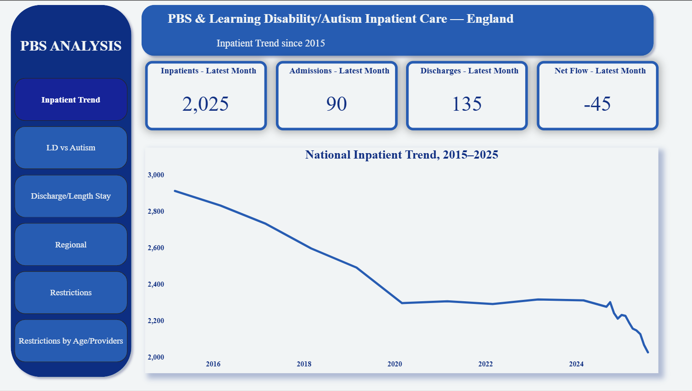

# Learning disability & autism inpatient care in England: what the national data show

A Power BI analysis of NHS England data on people with a learning disability and/or autism in NHS-commissioned inpatient care, built to ask a population-level question:

**Since the Transforming Care programme, which promoted Positive Behaviour Support (PBS) and community-based care, how have inpatient numbers, discharges, length of stay, regional variation and restraint actually moved?**

> **Read this first.** This is a correlational, population-level analysis. NHS data do not record which hospital or ward uses PBS, so this project **cannot show that PBS causes any outcome**. It shows what the national picture looks like, and where it raises questions for further study.

*Author: Samuel Ejedegba. Independent project; views are my own and do not represent my employer.*

## Dashboard

Six pages: overview, discharges and destinations, length of stay, regional variation, restraint trend and type, restraint by age and provider.

| | |
|---|---|
|  |  |
|  |  |
|  |  |

- Power BI file: [`dashboard/PBS_analysis.pbix`](dashboard/PBS_analysis.pbix)
- Live report: [Open in Power BI](https://app.powerbi.com/view?r=eyJrIjoiNWNhNTEyMmQtODZkNC00MzM1LTljNmEtZmNmMDBhMmExOTE2IiwidCI6ImZmMGYzZTNhLTNlNTMtNDU0Zi1iMmI1LTZjNjg3NTNiOGVlNCJ9)

## Headline findings

| Finding | Figure |
|---|---|
| Inpatients, Mar 2015 → Aug 2025 | 2,910 → 2,025 (−31%), with a plateau around 2,300 in 2020–2024 |
| Aug 2025 flow | 90 admissions, 135 discharges (net −45) |
| Discharges going to community settings | 85.2% |
| In hospital for over a month | 96.0% |
| In hospital for over 2 years | 49.6% |
| Regional rate per million (Aug 2025) | Lowest 24, England 43, highest 76 (3× gap) |
| Restraint interventions, latest month | 8,635 (peak 10,045; +23.7% since Oct 2024) |
| Under-18s | 35% of all interventions; about 1,810 children |

Autism-only inpatients have risen while learning-disability-only inpatients have fallen. NHS England reports an 84% rise in autism-only (no learning disability) inpatients between March 2017 (585) and July 2025 (1,080) ([NHS England board paper, 23 Sept 2025](https://www.england.nhs.uk/long-read/update-on-learning-disability-and-autism-programme/)). 2017 is used as the baseline because NHS England itself says reliable autism figures for March 2015 are unavailable.

## Data sources

All data are published by NHS England / NHS Digital under the [Open Government Licence v3.0](https://www.nationalarchives.gov.uk/doc/open-government-licence/version/3/).

- **Assuring Transformation (AT)**: inpatient numbers, admissions, discharges, length of stay, regional rates. [Link](https://digital.nhs.uk/data-and-information/data-collections-and-data-sets/data-collections/assuring-transformation)
- **Mental Health Services Data Set (MHSDS)**: restrictive interventions. [Link](https://digital.nhs.uk/data-and-information/data-collections-and-data-sets/data-sets/mental-health-services-data-set)
- Monthly downloads: [Learning disability services statistics](https://digital.nhs.uk/data-and-information/publications/statistical/learning-disability-services-statistics)

The files in [`/data`](data) are my reshaped versions of the NHS tables, laid out for Power Query (one fact table per grain, with `Unit` and `Notes` columns). Each workbook has a README sheet describing the tables.

| File | Contents |
|---|---|
| `AT_Data_PowerQuery_Ready.xlsx` | National time series, category snapshot, regional monthly and regional category tables, ICB dimension |
| `MHSDS_Restraint_PowerQuery_Ready.xlsx` | National restraint trend (19 months), restraint by age, restraint by provider (July 2025) |

## Method

1. Extracted the relevant tables from the NHS workbooks (AT and 20 monthly MHSDS files).
2. Unpivoted into tidy fact tables in Python; suppressed cells (`*`, `z`, `:`) moved into a `Notes` column; `Unit` column separates counts from percentages.
3. Loaded into Power Query, modelled with a date dimension linking all fact tables.
4. Built DAX measures ([`dax_measures.md`](dax_measures.md)) and a six-page report.

## Caveats you should know about

- **No PBS attribution.** Nothing here links a provider or ward to PBS use.
- **"NHS-commissioned" is not "NHS-run".** It includes NHS trusts and independent providers.
- **Restraint data are undercounted**, with completeness improving over time, so part of any rise may be better reporting. NHS guidance also advises against deriving per-person rates from these data; the "interventions per child" figure is descriptive only.
- **Counts are rounded to the nearest 5** and small numbers are suppressed.
- **Rate-per-million error.** NHS England notes a wrong ONS population year in AT Table 5.2 for Oct 2023–Jun 2025; regional rates are taken from the Aug 2025 snapshot.
- **Snapshot tables.** Category and regional breakdowns are single-month (Aug 2025) views.
- **Discharge destinations** are only available from March 2022.
- **Restraint by provider** is July 2025 only and heavily suppressed (about 80% of cells blank). Provider totals are usable for 54 of 60 providers. Provider names come from the public NHS publication and say nothing about quality or practice on their own.

## Repository contents

```
data/        Power Query-ready workbooks
dashboard/   Power BI file
docs/        Conference abstract
images/      Dashboard screenshots
dax_measures.md
```

## Licence

Code and documentation: MIT (see `LICENSE`). Data: contains public sector information licensed under the Open Government Licence v3.0.
